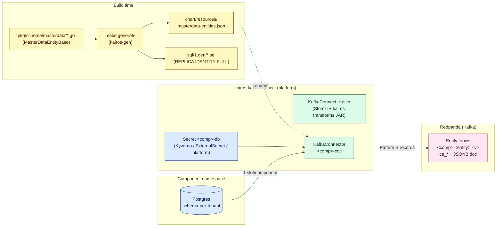

# Master-data CDC — Architecture (Debezium)

Companion to [`SETUP.md`](./SETUP.md). SETUP tells you *what to type*; this doc
tells you *why the system looks the way it does*.

This replaces the older Redpanda Connect `postgres_cdc` design. The key change:
**capture and CloudEvents shaping happen in one Debezium KafkaConnector** with
ONE replication slot per component (covering every tenant schema), instead of
one slot per *(component × tenant × entity)*. That is what lets the platform
scale to 100s of component databases and 100s of tenant schemas without
exhausting Postgres `max_replication_slots`.

If you only have time for one diagram, jump to
[§3 End-to-end topology](#3-end-to-end-topology).

**Hands-on walkthrough:** [`ADDING-MASTERDATA-ENTITIES.md`](./ADDING-MASTERDATA-ENTITIES.md)  
**Mechanism / headers:** [`MASTERDATA-CDC-MECHANISM.md`](./MASTERDATA-CDC-MECHANISM.md)

---

## 1. Why a single tier

| Concern | Owner | Why |
|---|---|---|
| **Capture** (read WAL, emit row changes) | **Debezium** PostgreSQL connector on a shared **Kafka Connect** cluster (managed by **Strimzi**) | One slot/publication per component, multi-schema in a single connector. Scales horizontally by adding Connect workers, not slots. |
| **Transform** (entity `data` doc + CloudEvents Pattern B headers) | **`MasterDataCdcTransform`** custom SMT (JAR in Connect image) + Debezium `ExtractNewRecordState` | No downstream consumer. Parses JSONB `data`, routes to entity topics, sets full `ce_*` headers. |

There is no second runtime reading Kafka and rewriting messages. The connector
writes directly to `<component>.<entity>.<version>.<tenantId>` topics with Pattern B
headers and the JSONB entity document as the value.

---

## 2. Glossary

| Term | Meaning |
|---|---|
| **Debezium** | Kafka-Connect-based CDC engine. Its PostgreSQL connector decodes the WAL via `pgoutput` logical decoding. |
| **Strimzi** | Kubernetes operator for Kafka / Kafka Connect. We declare a `KafkaConnect` cluster and per-component `KafkaConnector` CRs; Strimzi reconciles them. |
| **KafkaConnect CR** | Declares the shared Connect cluster (workers, image, config providers). Lives in the platform repo (`kairos-kafka-connect`). |
| **KafkaConnector CR** | Declares ONE Debezium connector for a component. Rendered by the **component chart** from `masterdata-entities.json` × tenants. |
| **Replication slot / publication** | Postgres-side logical-replication bookmark. We allocate **one per component** (`kairos_dbz_<comp>` / `kairos_dbz_<comp>_pub`), shared across all tenant schemas. |
| **REPLICA IDENTITY FULL** | Per-table setting (emitted by `make generate`) so UPDATE/DELETE carry the full prior row image. |
| **Output topic** | `<component>.<entity>.<version>.<tenantId>` at runtime (prefix from `masterdata-entities.json`, e.g. `todo-demo.company.1.<tenantUuid>`). Tenant also in `ce_ifstenantid`. |
| **CloudEvents Pattern B** | CE attributes promoted to `ce_*` Kafka headers; Kafka **key** = row `id` UUID string; Kafka **value** = parsed **JSONB entity document**. |
| **MasterDataCdcTransform** | Custom Kafka Connect SMT shipped in `kairos-connect-transforms.jar` on the Connect image. |

---

## 3. End-to-end topology

---

## 4. The `KafkaConnector` — capture and transform

Rendered by `chart/templates/debezium/kafka-connector.yaml`:

**Capture**

- `slot.name: kairos_dbz_<comp>`, `publication.name: kairos_dbz_<comp>_pub`,
  `publication.autocreate.mode: filtered` — one slot for the whole component.
- `schema.include.list` = every `debezium.tenants` UUID schema, or a UUID regex
  when `tenants` is empty (default).
- `table.include.list` = master-data tables from `masterdata-entities.json`.
- Credentials via Strimzi `KubernetesSecretConfigProvider` from
  `${secrets:<platformNs>/<comp>-db:user|password}`. The secret is provisioned by
  the environment (Kyverno locally) or by the component chart's
  `ExternalSecret` (`db-secret.yaml`) on Nexus — see
  [`ADDING-MASTERDATA-ENTITIES.md`](./ADDING-MASTERDATA-ENTITIES.md) §6.
  The toolkit no longer copies credentials in a post-deploy hook.

**In-connector transform chain** (`unwrap,md`)

1. `ExtractNewRecordState` — `{id, data}` + `__op`, `__source_schema`,
   `__source_table`, `__ts_ms` helper fields (`delete.handling.mode: rewrite`).
2. `MasterDataCdcTransform` — reads `entities.json` from connector config;
   maps table → tenant-scoped entity topic / `ce_type` / `ce_source`; sets Kafka key
   to row `id` UUID string; parses JSONB `data` string → object value; sets
   `content-type`, `ce_ifstenantid`, `ce_subject`, `ce_id`, `ce_time`,
   `ce_specversion`, `ce_datacontenttype`, and `ce_ifsmessagetype` (`master-data`).
   Does **not** emit `ce_operation` or `ce_ifsmasterdata`.

   Platform contract (new producers): `ce_type` = `<component>.<entity>.<version>`;
   `ce_source` = component name; route on `ce_ifsmessagetype: master-data`.
   Adapter accepts legacy `ce_ifsmasterdata: true`. Consumers accept both
   versioned and (for v1) version-less `ce_type` filters.

The `isData` predicate skips heartbeat/schema-change records.

**Scaling:** one slot per component. Add Connect workers to spread connectors.

---

## 5. What scales, what doesn't

| Axis | Old (postgres_cdc) | New (Debezium) |
|---|---|---|
| Replication slots | component × tenant | **component** only |
| Tenants per slot | 1 | **all** (multi-schema connector) |
| Adding a tenant | new slot + stream YAML | connector restart (UUID regex) or redeploy |
| Downstream consumer | Redpanda Connect | **none** (custom SMT in connector) |
| Horizontal scale | single Connect pod | add Strimzi Connect workers |

---

## 6. Cross-references

- Adding a master-data entity (producer + consumer, step by step): [`ADDING-MASTERDATA-ENTITIES.md`](./ADDING-MASTERDATA-ENTITIES.md) (includes chart scaffold, secret provisioning, and automatic `masterdata-entities.json` generation)
- Mechanism / envelope: [`MASTERDATA-CDC-MECHANISM.md`](./MASTERDATA-CDC-MECHANISM.md)
- Setup / onboarding: [`SETUP.md`](./SETUP.md)
- Platform repo (Connect image + custom SMT): `kairos-kafka-connect`
- Decision record / evaluation: `docs/DEBEZIUM-CDC-EVALUATION.md`
