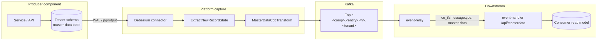

# Master-data CDC — underlying mechanism

Technical reference for **how** Kairos captures master-data changes from
PostgreSQL and publishes them to Kafka. For a step-by-step walkthrough, see
[Adding a master-data entity](./ADDING-MASTERDATA-ENTITIES.md) and the
`kairos-create-masterdata-entity` skill.

Companion docs: [Architecture rationale](./MASTERDATA-CDC-ARCHITECTURE.md) (why one
slot per component), [SETUP](./SETUP.md) (commands and prerequisites).

---

## Platform envelope contract (confirmed)

These rules apply to CDC and in-process master-data production.

| Attribute | Rule | Example |
|---|---|---|
| **`ce_type`** | `<component>.<entity>.<version>` — version **included** | `countries.company.1` |
| **`ce_source`** | Owning **component name** only (not topic name) | `countries` |
| **`ce_ifsmessagetype`** | `master-data` | `master-data` |

Other standard CloudEvents headers: `ce_ifstenantid`, `ce_subject` (row id),
`ce_id`, `ce_time`, `ce_specversion`, `ce_datacontenttype`, `content-type`.

**Kafka topic (per tenant):** `<component>.<entity>.<version>.<tenantId>`

**Kafka key:** row `id` (UUID string). **Value:** parsed JSONB entity document
(Pattern B — no `{id,data}` wrapper on the wire).

Descriptor in `chart/resources/masterdata-entities.json` (one entry per entity;
the template ships with `"entities": []`, and the `company` entry below is
illustrative):

```json
{
  "entityName": "company",
  "version": 1,
  "tableName": "companies",
  "topic": "countries.company.1",
  "ceType": "countries.company.1",
  "ceSource": "countries"
}
```

### Consumer `topic-config.json` (v1 master-data)

`kairos-gen` emits **both** filter types for master-data **v1** subscriptions:

```json
"types": ["countries.company", "countries.company.1"]
```

- Versioned `ce_type` matches CDC and runtime sender output.
- **v2+** master-data entities get the versioned type only.

---

## End-to-end data path



1. **Write** — producer persists JSONB row in tenant schema (normal repository).
2. **Capture** — one Debezium connector per component reads WAL via a single
   replication slot (`kairos_dbz_<component>`).
3. **Transform** — in-connector SMT chain sets topic, key, value, CloudEvents headers.
4. **Deliver** — event-relay filters by topic + `ce_type`; event-handler upserts
   read model when `ce_ifsmessagetype` is `master-data`.

There is **no** second Kafka consumer rewriting messages (unlike the legacy
Redpanda Connect `postgres_cdc` design).

---

## Build-time generation (`kairos-gen`)

`make generate` discovers structs that embed `MasterDataEntityBase` under
`pkg/schema` (default `--schema-lib-path`) and writes the outputs below. The
CDC descriptor is not hand-authored: the toolkit passes `--masterdata-output`
when such an embedder is present. There is no `masterdata-cdc.mk` include.

| Output | Purpose |
|---|---|
| `sql/1.gen/<table>.sql` | Table DDL + `REPLICA IDENTITY FULL` |
| `chart/resources/masterdata-entities.json` | Connector entity map: table, topic prefix, `ceType`, `ceSource` |
| Consumer `topic-config.json` (on subscribers) | Relay subscription per entity topic + type filter |

The Helm chart renders a `KafkaConnector` CR from `masterdata-entities.json` when
`debezium.enabled` is true.

---

## Debezium connector (capture layer)

Rendered from `chart/templates/debezium/kafka-connector.yaml`:

| Setting | Behaviour |
|---|---|
| `slot.name` | `kairos_dbz_<component>` — **one slot per component**, all tenant schemas |
| `publication.name` | `kairos_dbz_<component>_pub` (or platform-owned name in GitOps) |
| `schema.include.list` | UUID tenant schemas (explicit list or regex) |
| `table.include.list` | Master-data table names from `masterdata-entities.json` |
| `database.hostname` | CNPG primary `<cluster>-rw` (not PgBouncer — replication cannot use pooler) |
| `slot.failover` | `true` on PG17+ so slot survives CNPG failover |
| `snapshot.mode` | `initial` or `no_data` — controls whether existing rows are snapshotted |
| `autoRestart` | Strimzi restarts a FAILED task with backoff (`debezium.autoRestart.enabled`, default `true`) |

Credentials: Strimzi secret config `${secrets:kairos-kafka-connect/<comp>-db:…}`.
The DB role needs **`replication`** and read access to captured tables.

---

## In-connector transform chain

Configured as `transforms: unwrap,md` on the connector.

### 1. `ExtractNewRecordState` (`unwrap`)

Flattens Debezium envelope to `{ id, data, __op, __source_schema, __source_table, __ts_ms }`.
Delete tombstones dropped; deletes rewritten for downstream handling.

### 2. `MasterDataCdcTransform` (`md`)

Reads `transforms.md.entities.json` (= `masterdata-entities.json` from chart).

Per row:

- Resolve tenant from `__source_schema` (UUID schema name).
- Resolve entity route from `__source_table`.
- **Topic:** `<component>.<entity>.<version>.<tenantId>`.
- **Headers:** platform contract above (`ce_ifsmessagetype: master-data`, versioned `ce_type`, component `ce_source`).
- **Value:** parse JSONB `data` string to JSON object.
- **Key:** row `id` UUID string.

Implementation: `kairos-kafka-connect` → `MasterDataCdcTransform.java` (JAR on Connect image).

---

## Postgres requirements

| Requirement | Why |
|---|---|
| `wal_level = logical` | Logical decoding |
| Publication covering master-data tables | Debezium `pgoutput` |
| `REPLICA IDENTITY FULL` on entity tables | UPDATE/DELETE carry full row |
| App role with `REPLICATION` + read | Connector connection |
| Direct connection to primary `-rw` | Pooler cannot carry replication slots |
| Password ≥ 14 chars (Nexus FIPS) | Connect image BouncyCastle FIPS |

---

## Scaling model

| Axis | Model |
|---|---|
| Replication slots | **One per producer component** (not per tenant or entity) |
| Connect workers | Horizontal — more connectors / tasks spread across workers |
| Topics | One compacted topic per `(component, entity, version, tenant)` |
| Consumer read models | Each subscriber maintains local PostgreSQL copy via mapper |

See [MASTERDATA-CDC-ARCHITECTURE.md §5](./MASTERDATA-CDC-ARCHITECTURE.md) for old vs new slot comparison.

---

## Verification

```bash
# Connector AND task state — the connector can report RUNNING while its only
# task is FAILED (autoRestart retrying), so check both.
kubectl -n kairos-kafka-connect get kafkaconnector <comp>-cdc \
  -o jsonpath='{.status.connectorStatus.connector.state}{" / "}{.status.connectorStatus.tasks[0].state}{"\n"}'

# Slot health
psql "$DSN" -c "
  SELECT slot_name, active, wal_status,
         pg_size_pretty(pg_current_wal_lsn() - restart_lsn) AS lag
  FROM pg_replication_slots WHERE slot_name = 'kairos_dbz_<comp>';"

# Sample record headers (Redpanda Console or rpk)
# Expect: ce_type=<comp>.<entity>.<version>, ce_source=<comp>,
#         ce_ifsmessagetype=master-data
```

---

## Related documentation

- [MASTERDATA-CDC-ARCHITECTURE.md](./MASTERDATA-CDC-ARCHITECTURE.md) — design rationale, glossary, topology diagram
- [SETUP.md](./SETUP.md) — platform prerequisites and troubleshooting
- [ADDING-MASTERDATA-ENTITIES.md](./ADDING-MASTERDATA-ENTITIES.md) — hands-on producer walkthrough
